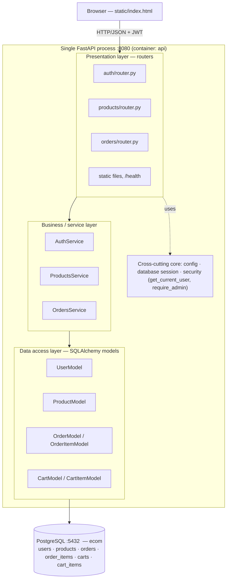
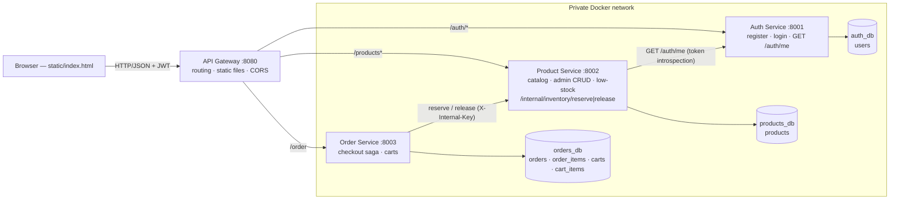
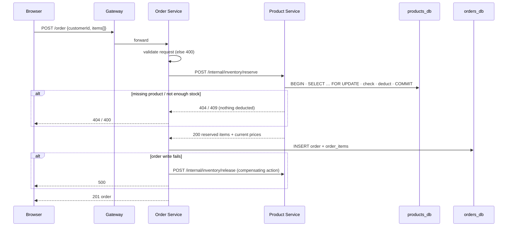

# CS 5319 Final Project — Group 09 (Flores, Cabrera)

## E-commerce Platform: Layered Monolith vs. Microservices

This repository contains two complete, working implementations of the same
e-commerce system, one for each candidate architecture style:

| Folder | Architecture style | Status |
|---|---|---|
| [`Selected/`](Selected/) | **Layered (modular) monolith** | **Final selection** |
| [`unselected/`](unselected/) | **Microservices** (API gateway + 3 services, database per service) | Candidate not selected |

Both implementations provide **the same functionality and the same public HTTP
API**, and both serve the same browser storefront (`static/index.html`):

- Customer registration and login with JWT authentication
- Role-based access control (RBAC): admin-only product management
- Product catalog with locally served product images
- Admin product creation and editing (details, price, inventory, image path)
- Low-stock product reporting for admins
- Simulated checkout that validates stock and deducts inventory
- Automated tests with `pytest`

Because the functionality is identical, the two folders can be compared
directly: the only difference is the **architecture**.

---

## Table of contents

1. [Repository layout](#1-repository-layout)
2. [Implementation platform](#2-implementation-platform)
3. [Download, install, and configure the platform](#3-download-install-and-configure-the-platform)
4. [Compiling the code](#4-compiling-the-code)
5. [Executing the system: Selected (layered monolith)](#5-executing-the-system-selected-layered-monolith)
6. [Executing the system: Unselected (microservices)](#6-executing-the-system-unselected-microservices)
7. [Using the application](#7-using-the-application)
8. [Architecture designs](#8-architecture-designs)
9. [Differences between the two architecture designs](#9-differences-between-the-two-architecture-designs)
10. [Rationale for the final selection](#10-rationale-for-the-final-selection)
11. [Additional notes](#11-additional-notes)

---

## 1. Repository layout

```text
.
├── README.md                     ← this document
├── Selected/                     ← FINAL: layered monolith
│   ├── app/
│   │   ├── main.py               Presentation entry point (FastAPI app, static files, router wiring)
│   │   ├── core/                 Cross-cutting layer: config, database session, security (JWT/RBAC)
│   │   └── modules/              Feature modules, each split into router → service → model layers
│   │       ├── auth/             Registration, login
│   │       ├── users/            User model
│   │       ├── products/         Catalog, admin CRUD, low-stock
│   │       ├── orders/           Checkout
│   │       └── cart/             Cart models
│   ├── migrations/               PostgreSQL schema (single shared database)
│   ├── static/                   Storefront (index.html) and product images
│   ├── tests/                    pytest suite
│   ├── seed.py                   Demo users and products
│   ├── Dockerfile
│   ├── docker-compose.yaml       2 containers: api + postgres
│   ├── requirements.txt
│   └── pytest.ini
└── unselected/                   ← CANDIDATE: microservices
    ├── docs/ARCHITECTURE.md      Component and sequence diagrams for the microservices design
    ├── services/
    │   ├── gateway/              API gateway: public entry point, routing, static files
    │   ├── auth_service/         Users, registration, login, token introspection (/auth/me)
    │   ├── product_service/      Catalog, admin CRUD, low-stock, internal inventory API
    │   └── order_service/        Checkout saga, carts
    │       (each service has its own Dockerfile, requirements.txt, migrations/, and seed.py where needed)
    ├── tests/                    pytest suite (unit, per-service, and end-to-end through the gateway)
    ├── docker-compose.yaml       7 containers: gateway + 3 services + 3 postgres databases
    ├── requirements.txt          Combined requirements for running the tests locally
    └── pytest.ini
```

---

## 2. Implementation platform

| Component | Version used | Notes |
|---|---|---|
| Language | **Python 3.12** | Docker images use `python:3.12-slim`. Local development and testing also used Python 3.12.4 (macOS) and Python 3.15.0. Any Python ≥ 3.10 works for local tests. |
| Web framework | **FastAPI** 0.110+ (tested with 0.163.1) | ASGI framework; served by **Uvicorn** (0.28+, tested 0.54.0) |
| ORM / DB driver | **SQLAlchemy 2.x async** (tested 2.1.8) with **asyncpg** (tested 0.32.0) | |
| Validation / config | **Pydantic 2.x** (tested 2.14.3), **pydantic-settings** | |
| Security | **PyJWT** (tested 2.15.1), **bcrypt** (tested 5.0.0) | JWT bearer tokens, bcrypt password hashing |
| Inter-service HTTP (microservices only) | **httpx** (tested 0.28.1) | Gateway proxying and service-to-service calls |
| Database | **PostgreSQL 16** (`postgres:16-alpine` image) | Runs in Docker, no local install needed |
| Containers | **Docker Engine 28.0.1 / 29.9.3** and **Docker Compose v2.33.1 / 5.7.0** | Docker Desktop for macOS |
| Testing | **pytest** (tested 9.2.0), **pytest-asyncio** (tested 1.5.0), **httpx**, **aiosqlite** (tested 0.22.1) | Tests use in-memory SQLite, so they need no Docker |
| OS | macOS (Apple Silicon). The Docker setup also works on Linux and Windows with Docker Desktop. | |

---

## 3. Download, install, and configure the platform

### 3.1 Python

1. Download Python 3.12 (or newer) from <https://www.python.org/downloads/>.
   - **macOS:** run the `.pkg` installer, or `brew install python@3.12` with Homebrew.
   - **Windows:** run the installer and check **"Add python.exe to PATH"**.
   - **Linux:** `sudo apt install python3 python3-venv python3-pip` (Debian/Ubuntu).
2. Verify the installation:
   ```bash
   python3 --version        # Windows: py --version
   ```

### 3.2 Docker and Docker Compose

1. Download **Docker Desktop** from <https://www.docker.com/products/docker-desktop/>
   (macOS, Windows, or Linux). Docker Compose v2 is included.
2. Install and **start Docker Desktop**. Wait until it reports that the engine is running.
3. Verify:
   ```bash
   docker --version
   docker compose version
   docker info              # must print server details, not "Cannot connect to the Docker daemon"
   ```

### 3.3 PostgreSQL

No local installation is needed. Docker Compose downloads and runs the
`postgres:16-alpine` image, and creates each database schema automatically from
the SQL files in the `migrations/` folders the first time a database volume is
created.

### 3.4 Get the source code

```bash
git clone https://github.com/alexflores196/CS5319-Final-Project-Group-09-Flores-Cabrera.git
cd CS5319-Final-Project-Group-09-Flores-Cabrera
```

### 3.5 Configuration

Neither implementation needs manual configuration to run locally. All settings
have development defaults and are overridden through environment variables in
the `docker-compose.yaml` files.

| Setting | Selected | Unselected | Default / purpose |
|---|---|---|---|
| Database URL | `GOOSE_DBSTRING` | `DATABASE_URL` (one per service) | Points at the Compose Postgres container(s) |
| Service URLs | — | `AUTH_SERVICE_URL`, `PRODUCT_SERVICE_URL`, `ORDER_SERVICE_URL` | Docker DNS names, e.g. `http://auth-service:8001` |
| Internal API key | — | `INTERNAL_API_KEY` | Shared secret for service-to-service inventory calls |
| JWT secret | hard-coded in `auth/service.py` | `JWT_SECRET_KEY` (auth-service) | Development value only |

> The credentials and secrets in this repository are for local development only.

---

## 4. Compiling the code

Python is an interpreted language, so there is no separate compile-and-link
step that produces a native binary. The project's build outputs are:

1. **Python bytecode (`.pyc`).** The interpreter compiles automatically on
   first import. To compile ahead of time and check that every file is
   syntactically valid:
   ```bash
   python3 -m compileall Selected/app unselected/services
   ```
2. **Docker images (the deployable executables).** Building the images
   installs all dependencies and packages each application into a runnable
   image:
   ```bash
   # Selected: produces image  selected-api
   docker compose -f Selected/docker-compose.yaml build

   # Unselected: produces images  unselected-gateway, unselected-auth-service,
   #             unselected-product-service, unselected-order-service
   docker compose -f unselected/docker-compose.yaml build
   ```
   To export an image as a portable file, for example to move it to another
   machine without rebuilding:
   ```bash
   docker save selected-api -o selected-api.tar
   docker load -i selected-api.tar
   ```

Bytecode caches (`__pycache__/`) and image tarballs are not committed: they
are generated, platform-specific, and the image tarballs (about 300 MB each)
are larger than GitHub's file size limit. The commands above recreate them
exactly.

### 4.1 Install dependencies and run the automated tests (no Docker needed)

From the repository root:

```bash
python3 -m venv .venv
source .venv/bin/activate            # Windows: .venv\Scripts\activate

# Selected (layered monolith)
python -m pip install -r Selected/requirements.txt aiosqlite
(cd Selected && python -m pytest -q)          # expected: 4 passed

# Unselected (microservices)
python -m pip install -r unselected/requirements.txt
(cd unselected && python -m pytest -q)        # expected: 27 passed
```

`aiosqlite` is listed separately for `Selected` because its tests use an
in-memory SQLite database. It is already included in
`unselected/requirements.txt`.

---

## 5. Executing the system: Selected (layered monolith)

From the repository root, with Docker Desktop running:

```bash
# 1. Build and start the API and database (2 containers)
docker compose -f Selected/docker-compose.yaml up --build -d
docker compose -f Selected/docker-compose.yaml ps

# 2. Seed demo users and products ONCE per fresh database
docker compose -f Selected/docker-compose.yaml exec api python seed.py
```

| URL | Purpose |
|---|---|
| <http://localhost:8080> | Storefront |
| <http://localhost:8080/docs> | Interactive API documentation (Swagger UI) |
| <http://localhost:8080/health> | Health check (`all good`) |

Stop it:

```bash
docker compose -f Selected/docker-compose.yaml down       # keep data
docker compose -f Selected/docker-compose.yaml down -v    # also delete the database volume
```

---

## 6. Executing the system: Unselected (microservices)

Both systems publish port **8080**, so stop one before starting the other.

```bash
# 1. Build and start the gateway, 3 services, and 3 databases (7 containers)
docker compose -f unselected/docker-compose.yaml up --build -d
docker compose -f unselected/docker-compose.yaml ps

# 2. Seed demo data ONCE per fresh set of databases (each service seeds its own DB)
docker compose -f unselected/docker-compose.yaml exec auth-service python seed.py
docker compose -f unselected/docker-compose.yaml exec product-service python seed.py
```

| URL | Purpose |
|---|---|
| <http://localhost:8080> | Storefront (served by the gateway) |
| <http://localhost:8080/health> | Gateway health check |
| <http://localhost:8080/health/services> | Health of every downstream service |

Only the gateway is reachable from the host. Each service's own Swagger UI is
at `/docs` inside the Docker network.

Inspect each service's own database:

```bash
docker compose -f unselected/docker-compose.yaml exec order-db   psql -U postgres -d orders_db   -c "select * from order_items"
docker compose -f unselected/docker-compose.yaml exec product-db psql -U postgres -d products_db -c "select id, name, quantity from products"
```

Stop it:

```bash
docker compose -f unselected/docker-compose.yaml down      # keep data
docker compose -f unselected/docker-compose.yaml down -v   # also delete the 3 database volumes
```

---

## 7. Using the application

The demo credentials are the same for both systems:

| Role | Email | Password |
|---|---|---|
| Admin | `admin@ecom.com` | `admin123` |
| Customer | `john@ecom.com` | `customer123` |

**Storefront walkthrough**

1. Open <http://localhost:8080> and sign in.
2. Browse the catalog and use the checkout panel to place an order. Inventory
   decreases immediately.
3. As the admin, open **Admin Panel**:
   - **Add Product**: name, description, category, price, inventory, and an
     image path such as `/static/images/products/wireless-headphones.jpg`.
   - **Manage Products**: edit any field, including price and inventory.
   - **Low stock**: lists products at or below 5 units.

**Public API (identical in both systems)**

| Method | Path | Auth | Description |
|---|---|---|---|
| `POST` | `/auth/register` | — | Register a customer |
| `POST` | `/auth/login` | — | Log in and receive a JWT |
| `GET` | `/products` | — | List active products |
| `POST` | `/products` | Admin | Create a product |
| `PUT` | `/products/{id}` | Admin | Update a product |
| `GET` | `/products/low-stock?threshold=5` | Admin | Products at or below the threshold |
| `POST` | `/order` | — | Place an order and deduct inventory |

Authenticated calls send `Authorization: Bearer <access_token>`.

Example using `curl`:

```bash
TOKEN=$(curl -s -X POST localhost:8080/auth/login -H 'Content-Type: application/json' \
  -d '{"email":"admin@ecom.com","password":"admin123"}' | python3 -c 'import sys,json;print(json.load(sys.stdin)["access_token"])')

curl -s "localhost:8080/products/low-stock?threshold=5" -H "Authorization: Bearer $TOKEN"
curl -s -X POST localhost:8080/order -H 'Content-Type: application/json' \
  -d '{"customerId":2,"items":[{"productId":1,"quantity":1}]}'
```

---

## 8. Architecture designs

### 8.1 Selected: Layered (modular) monolith

The whole system is **one deployable process** backed by **one database**.
The code is split two ways: horizontally into **layers**, and vertically into
**feature modules**.



**Layer rules**

| Layer | Location | Responsibility | May call |
|---|---|---|---|
| Presentation | `app/main.py`, `modules/*/router.py` | HTTP routing, request/response schemas, status codes | Business layer, core |
| Business | `modules/*/service.py` | Use cases: registration, authentication, checkout rules | Data layer |
| Data access | `modules/*/models.py`, `core/database.py` | ORM mapping and persistence | Database |
| Cross-cutting core | `app/core/` | Configuration, DB session provider, JWT and RBAC dependencies | — |

**Checkout in the monolith** is a single local ACID transaction. Inside one
`begin_nested()` block, `OrdersService` creates the order, reads each product,
checks its stock, deducts the quantity, and inserts the order items. Then it
commits. If any item fails, nothing is written.

### 8.2 Unselected: Microservices

The same features are split into **four independently deployable services**.
Each data-owning service has its **own PostgreSQL database**, and the services
talk to each other only over **HTTP/JSON**.



**Checkout in the microservices design** is a **saga**, because a single
database transaction can no longer cover both inventory (`products_db`) and
orders (`orders_db`):



Authenticated product calls take an extra network hop:
**browser → gateway → product-service → auth-service (`/auth/me`)**. In the
monolith, the same check is an in-process function call plus one query.
More sequence diagrams are in
[`unselected/docs/ARCHITECTURE.md`](unselected/docs/ARCHITECTURE.md).

**How the monolith's code maps to the microservices**

| Selected (monolith) | Unselected (microservices) |
|---|---|
| `app/main.py` (static files, health, router wiring) | `gateway` (static files, health, reverse-proxy routing table) |
| `modules/auth/*`, `modules/users/models.py` | `auth-service` + `auth_db.users` |
| `core/security.py` (`get_current_user`, `require_admin`) | auth-service `GET /auth/me`; product-service enforces `require_admin` locally |
| `modules/products/*` | `product-service` + `products_db.products` |
| `modules/orders/*`, `modules/cart/models.py` | `order-service` + `orders_db` |
| One database with cross-table foreign keys | Three databases; cross-service references are plain ID columns |
| In-process function calls | HTTP/JSON calls with timeouts and `503` on failure |
| One ACID transaction for checkout | Saga: reserve → persist → compensate |

---

## 9. Differences between the two architecture designs

| Dimension | Selected: layered monolith | Unselected: microservices |
|---|---|---|
| **Deployable units** | 1 application container | 4 application containers (gateway, auth, product, order) |
| **Runtime containers** | 2 (api + postgres) | 7 (4 apps + 3 postgres) |
| **Databases** | 1 shared schema | 3 separate databases (database per service) |
| **Component communication** | In-process Python function calls | Synchronous HTTP/JSON over the Docker network |
| **Connectors** | Procedure call, shared data store | REST calls, API gateway (reverse proxy), service-to-service API with shared key |
| **Data consistency** | Strong: one ACID transaction for checkout | Eventual within a request: saga with compensating `release` |
| **Referential integrity** | Database foreign keys (e.g. `cart_items.product_id → products.id`) | No cross-database foreign keys; services keep IDs and must tolerate dangling references |
| **Authentication** | `get_current_user` decodes the JWT and loads the user in the same process | product-service calls auth-service `/auth/me` for every protected request |
| **Network hops per admin request** | 1 (browser → api) | 3 (browser → gateway → product → auth) |
| **Failure modes** | All up or all down | Partial failures: any downstream outage returns `503`; this needs handling and tests |
| **Scalability** | Scale the whole app horizontally behind a load balancer | Scale each service on its own (e.g. only product-service under heavy catalog traffic) |
| **Deployability** | Any change redeploys the whole application | Each service redeploys on its own (if API contracts stay compatible) |
| **Fault isolation** | A crash or memory leak affects all features | A failing order-service doesn't stop browsing or login |
| **Team autonomy / tech heterogeneity** | Shared codebase, single stack | Each service could be owned by a separate team and use a different stack |
| **Code size** (application `.py`, excluding seeds) | ~570 lines in 14 files | ~1,130 lines in 33 files (about 2×), mostly config, HTTP clients, proxying, and error mapping |
| **Testing** | 1 app, 1 test DB, 4 end-to-end tests | 4 apps, 3 test DBs wired over in-process HTTP. 27 tests, including outage and compensation cases that only exist in this style |
| **Operational overhead** | Low: one log stream, one DB to back up and migrate | Higher: 4 log streams, 3 DBs to back up and migrate, service discovery, internal secrets |
| **Observability / debugging** | One stack trace covers the whole request | A request crosses 3 processes; tracing needs correlation IDs or distributed tracing |

### Quality-attribute summary

| Quality attribute | Better style for **this** project | Why |
|---|---|---|
| Simplicity / maintainability for a 2-person team | Monolith | Half the code and one deployable; the layers already separate concerns |
| Data consistency (inventory correctness) | Monolith | Checkout is a real ACID transaction; no compensation logic to get wrong |
| Performance / latency | Monolith | No serialization or network hops between components |
| Reliability (operational) | Monolith | Fewer moving parts and fewer partial-failure paths |
| Independent scalability | Microservices | Each service can scale on its own |
| Independent deployability / team scaling | Microservices | Services are released separately |
| Fault isolation | Microservices | One service's failure is contained |

---

## 10. Rationale for the final selection

We selected the **layered (modular) monolith**. Both systems were built and
run with the same features, so this decision is based on two working
implementations rather than on theory alone.

1. **Scope and team size.** The system has three closely related business
   capabilities (identity, catalog/inventory, orders) built by a two-person
   team. Microservices pay off when there are many teams that need to deploy
   on their own. With one team, that benefit doesn't apply, but the costs
   still do.

2. **Checkout needs a single transaction.** The most important rule in the
   system is that stock must never be oversold and an order must never exist
   without its stock being deducted. In the monolith this is one ACID
   transaction. In the microservices version, the same rule needed an
   internal reserve/release API, a saga with a compensating action, `SELECT …
   FOR UPDATE` in a different service, and extra tests for failures partway
   through. Even then, if a `release` call fails after an order write fails,
   stock is lost and someone has to fix it by hand.

3. **Complexity measured in our own code.** The microservices version needed
   about **2× the application code** (~1,130 vs ~570 lines), **3.5× the
   containers** (7 vs 2), and **three databases** to migrate and seed. Almost
   none of the extra code adds user-facing features. It is infrastructure:
   proxying, HTTP clients, timeouts, mapping errors between services, and
   internal authentication.

4. **Performance.** Every admin request in the microservices version takes
   three network hops and two extra JSON round trips (the gateway proxy and
   token introspection). In the monolith these are function calls. At our
   scale there is no load that would justify that overhead.

5. **Reliability.** The microservices design adds new partial-failure modes,
   such as auth-service being down while product-service is up. Each one needs
   a `503` path and a test. The monolith fails as one unit, which is simpler
   to understand and operate.

6. **We keep the option to migrate later.** The monolith is modular: auth,
   products, orders, and cart are separate packages with their own routers,
   services, and models, under a shared core. The `unselected/` implementation
   shows these modules can be pulled out into services without changing the
   public API or the frontend. If the system later needs independent scaling
   or separate teams, it can move to microservices one module at a time.

**Trade-offs we accept with this choice:** the whole application has to be
redeployed for any change, it can only scale as a whole, and a fatal bug in one
module can take down the entire API. For a single-team course project with
modest traffic, these are acceptable.

---

## 11. Additional notes

- **Same API, same frontend.** The four scenario tests in
  `Selected/tests/test_api.py` are copied unchanged into
  `unselected/tests/test_api.py` and pass against the microservices gateway.
  This is direct evidence that both architectures provide the same
  functionality.
- **Verified end-to-end in Docker.** The microservices stack was built and run
  in Docker against the three PostgreSQL databases. Through the gateway we
  checked registration, login, the RBAC outcomes (401 / 403 / 201), product
  update, low-stock reporting, a successful order (stock decreased, and the
  order item recorded the purchase price in `orders_db`), an out-of-stock
  rejection (400), an all-or-nothing rejection with a missing product (404, no
  stock deducted), and that `/internal/*` cannot be reached from outside (404).
- **Test design.** Both suites run without Docker using in-memory SQLite. In
  `unselected/tests/conftest.py`, every service gets its own isolated database,
  and calls between services go through `httpx.ASGITransport`. This way the
  gateway → service and service → service HTTP hops are really exercised,
  including outage (`503`) and saga-compensation cases.
- **Security notes (both systems, development only).** The JWT secret and
  database passwords are hard-coded development defaults. `/auth/register`
  accepts a `role` field, and `POST /order` trusts the `customerId` in the
  request body instead of taking it from the token. Both systems keep these
  behaviours on purpose, so they stay functionally identical for comparison.
  A production version should fix them.
- **Port conflict.** Both systems publish port `8080`. Run
  `docker compose … down` on one before starting the other.
- **Fresh data.** Seed scripts are meant to run once per fresh database.
  Running them again fails on duplicate demo emails. Use `down -v` to start
  over.
