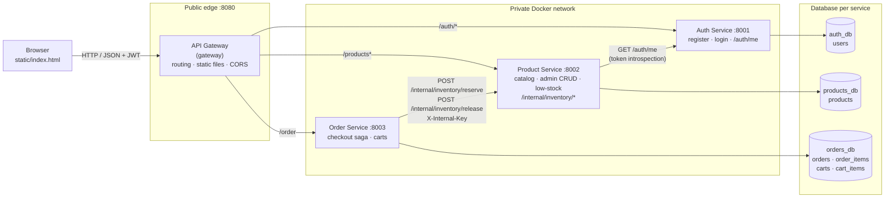
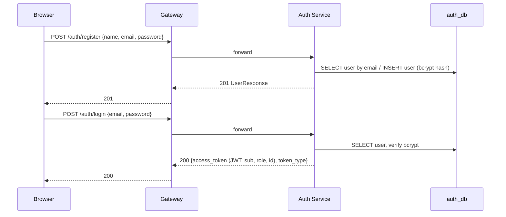
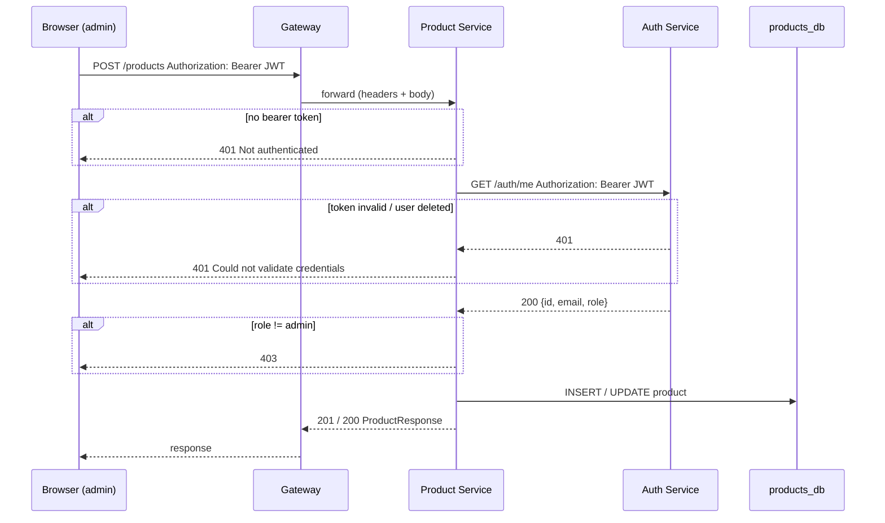

# Unselected Architecture: Microservices

This is the `Selected` layered/modular monolith split into independently
deployable services. The public API, the frontend, and the behaviour are the
same; what changes is where each responsibility runs and who owns which data.

## Component diagram



## Monolith → microservice mapping

| `Selected` (monolith) | `unselected` (microservices) |
|---|---|
| `app/main.py` (static files, `/health`, router wiring) | **gateway**: static files, `/health`, reverse-proxy routing table |
| `app/modules/auth/*`, `app/modules/users/models.py` | **auth-service** + `auth_db.users` |
| `app/core/security.py` (`get_current_user`, `require_admin`) | auth-service `GET /auth/me`; product-service calls it and enforces `require_admin` locally |
| `app/modules/products/*` | **product-service** + `products_db.products` |
| `app/modules/orders/*` | **order-service** + `orders_db.orders`, `order_items` |
| `app/modules/cart/models.py` | order-service (`carts`, `cart_items`) |
| One PostgreSQL database with cross-table FKs | Three PostgreSQL databases; cross-service references (`customer_id`, `product_id`) are plain IDs |
| In-process function calls | HTTP/JSON between services |
| One DB transaction for checkout | Saga: reserve stock → save order → compensate on failure |

## Request flows

### 1. Register / login



### 2. Admin creates or updates a product (RBAC)



`GET /products/low-stock?threshold=N` follows the same path. The gateway
forwards the query string unchanged. `GET /products` is public and skips the
auth call.

### 3. Checkout (`POST /order`): saga with compensation

```mermaid
sequenceDiagram
    participant B as Browser
    participant G as Gateway
    participant O as Order Service
    participant P as Product Service
    participant PDB as products_db
    participant ODB as orders_db

    B->>G: POST /order {customerId, items[]}
    G->>O: forward
    O->>O: validate (customerId != 0, items not empty) → else 400

    Note over O,P: Step 1: reserve inventory
    O->>P: POST /internal/inventory/reserve (X-Internal-Key)
    P->>PDB: BEGIN; SELECT … FOR UPDATE per item;<br/>check stock; deduct; COMMIT
    alt product missing
        P-->>O: 404 → O returns 404
    else insufficient stock
        P-->>O: 409 (whole reservation rolled back) → O returns 400
    end
    P-->>O: 200 [{product_id, quantity, price_in_cents}]

    Note over O,ODB: Step 2: persist order
    O->>ODB: INSERT order + order_items (price captured at purchase)
    alt order write fails
        O->>P: POST /internal/inventory/release (compensation)
        O-->>B: 500
    end
    O-->>G: 201 OrderResponse
    G-->>B: 201
```

Status codes match the monolith: `400` for validation or out-of-stock errors,
`404` for an unknown product, and `201` on success. The new failure mode is a
downstream service being unreachable, which returns `503`.

## Design decisions

- **API gateway as the single entry point.** The browser still talks only to
  `:8080`, so `static/index.html` needs no changes. `/internal/*` routes are
  never forwarded, so they can't be reached from outside the network.
- **Database per service.** Each service owns its schema and migrations.
  Foreign keys that crossed module boundaries (`cart_items.product_id`,
  `carts.user_id`) become plain ID columns.
- **Token introspection instead of shared user tables.** product-service no
  longer reads `users`. It asks auth-service `GET /auth/me`, which keeps the
  monolith's behaviour that a deleted user's token stops working and that the
  role comes from the database, not only from the JWT.
- **Saga for checkout.** The monolith deducted stock and wrote the order in
  one transaction. Here product-service reserves all items atomically in its
  own transaction. order-service then writes the order and, if that fails,
  calls `release` to return the stock.
- **Internal API key.** Service-to-service endpoints require the
  `X-Internal-Key` header, as a second guard alongside the network boundary.
